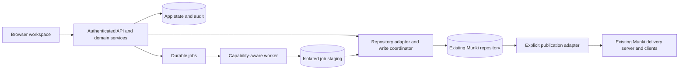

# Architecture exploration

Status: proposed boundaries, not an implemented system · 2026-10-15

## Shape

Start with a modular application, a durable job runner, and a repository adapter.
The browser never receives filesystem credentials. Add a remote worker only for
operations the application host cannot perform. Avoid turning each module into
a separate network service before that is necessary.

The final publication step is deployment-specific. Editing files on a directory
already served to clients can expose changes immediately. The UI must label such
a repo as **live on save**, and cannot promise a separate publish boundary.
Prefer a separate authoring checkout and published snapshot where the delivery
adapter can switch complete revisions. Verify atomic publication for each adapter;
an object-store prefix copy is not an atomic multi-object transaction.

## Domain modules

| Module | Responsibility |
| --- | --- |
| Repository | Configured roots, capabilities, path identities, scan revisions |
| Metadata | Typed plist/YAML values, unknown keys, source preservation, validation |
| Packages/manifests | Editing rules, references, ordering, dependency graph |
| Change sets | Drafts, base revision, diff, validation, conflict/recovery state |
| Jobs | Durable lifecycle, progress, cancellation, retries, worker capabilities |
| Git/publication | Optional commits, branch state, deployment-specific release |
| Identity/audit | Repository authorization and attributable operations |

Suggested eventual tree: `apps/web`, `services/api`, `packages/contracts`,
`workers/macos`, `deploy/compose`, `infrastructure`, and `tests/fixtures`.
Create directories only as implementation reaches them.

## Stack comparison

React, TypeScript, and Vite are the proposed browser stack: a rich workspace
without an initial SSR requirement. Typed request contracts should be generated
from a versioned API schema instead of maintained twice by hand.

| Backend | Advantages for this project | Cost and unresolved questions |
| --- | --- | --- |
| Python + FastAPI | API-oriented, OpenAPI support, standard-library plist parsing; keeps domain logic close to Munki's ecosystem | Must assemble identity, persistence, migrations, audit, and durable jobs deliberately |
| Modern Django + API layer | Built-in auth, sessions, permissions, ORM and migrations; practical for team administration | API/schema integration still needs a choice; keep repository files outside ORM ownership |
| TypeScript backend | Shared language/contracts with browser | Prove plist dates/data/integer handling and YAML fidelity; Mac tool boundary remains |
| Swift backend | Some domain ideas may transfer from MunkiStudio | Current AppKit/Foundation predicate and process code is not a portable web backend; requires a portability study |

A rewrite does not require rejecting Django. Choose based on the prototype's
auth, document fidelity, jobs, and operator experience. Do not choose framework
versions until scaffolding, then pin supported releases and lock dependencies.

## Data fidelity

- Identity is repository ID plus normalized relative path, not package `name`.
  Multiple versions and duplicate names are valid input.
- Preserve absent versus false, strings versus numbers, dates, data values,
  array order, unknown fields, scripts, and original format. Catalog order in a
  manifest has behavior and must not be alphabetized automatically.
- JSON cannot express every plist type. Specify a lossless API representation
  for data, dates, and integers beyond JavaScript's safe range before editing.
- Track raw bytes plus a typed document. A no-op edit writes nothing. A changed
  file gets a preview of formatting differences before save.
- YAML compatibility follows the selected Munki versions, their parsers, scalar
  rules, and tooling. Safe loaders, bounded aliases/depth/size, and preserved
  string versions are required. Comments and formatting fidelity need a codec
  spike; never silently discard them. Unsupported files stay read-only.
- The search index is derived. Drafts, audit, identity, and job state are durable
  app state and need backup independently of the repo.
- Catalogs are generated artifacts. Prefer the official compatible tool through
  a worker over reimplementing catalog semantics at the outset.

## Writes and concurrent editors

Each read returns a document revision derived from original bytes. Each save
includes that base revision. Under a per-repo writer lock, re-read, compare,
validate, journal the proposed changes, and write via same-filesystem temporary
files and rename. Flush as appropriate, update the index, and append audit state.
Report failure explicitly and keep recovery evidence.

A rename makes one replacement atomic; it does not make a multi-file change
transactional. Journal batch steps and define crash recovery. Editing an include
graph or generating catalogs must not leave the system claiming an incomplete
batch succeeded.

An application lock does not lock out AutoPkg, a CLI, a second deployment, or
MunkiStudio. Hash checks detect stale reads but cannot eliminate the final
check/write race with an uncooperative external writer. Writable deployments
must use a shared locking contract or an application-owned authoring checkout
with reviewed synchronization. A direct live mount remains read-only until that
coordination is proven. Do not promise conflict-free concurrent arbitrary writers.

## Jobs and the macOS boundary

Separate portable parsing, graph validation, and editing from tool execution.
MunkiStudio currently shells out to Munki tools and bridges Foundation
`NSPredicate`. Treat each capability independently: `catalog.generate`,
`installer.inspect`, `icon.extract`, `package.build`, and `predicate.validate`.
Probe tool versions and supported flags; do not infer capability from OS alone.

The job contract includes an ID, repo ID, immutable input revision, operation,
validated arguments, tool requirements, and an idempotency key. Workers return
structured results and staged artifacts with hashes. Inputs/outputs must be
verified before the sole writer applies them. Lease, heartbeat, bounded retries,
timeouts, and durable terminal state prevent a browser disconnect from losing work.
Progress can use SSE or polling; neither is the durable job record.

A Mac worker is an option for official installer inspection, packaging, icon
extraction, and exact predicate handling. A Linux deployment can browse and edit
metadata without pretending all those actions work in a container. Catalog
generation on Linux is a research item until a pinned toolchain passes parity
tests. Never execute package lifecycle scripts as part of metadata inspection.

## Authentication and execution boundary

Plan for OIDC-backed server sessions with secure cookies, CSRF protection for
mutations, and server-side repository authorization. Proposed roles: Viewer,
Editor, Publisher, Administrator. This is application policy, independent of
Git credentials and client download credentials. Networked writable access waits
for an identity decision and implementation.

Configured repo roots cannot come from arbitrary browser paths. Enforce path and
symlink containment, bounded parsing, sanitized rich text, private upload staging,
and constrained worker operations. Launch allowlisted executables with argument
arrays. A script editor edits data; it does not provide an application-host shell.
Git hooks, filters, credentials helpers, remote URLs, and external diff drivers
need explicit trust policy before allowing repo-supplied execution. Never mount
the host Docker socket to implement jobs.

## Verification that matters

Use fixture parity with supported Munki tools, codec round trips, stale-write and
crash-recovery tests, unauthorized/path-escape requests, cancellation/retry tests,
and browser tests for one complete edit/review workflow. Client behavior needs a
disposable real Munki client; a schema-valid file alone does not prove deployment.
