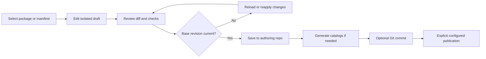

# Design direction

Status: exploratory; [workspace study](design/workspace.html) uses invented data.

## MunkiStudio in the browser

Preserve the reference app's source-list sidebar, searchable object list, and
structured editor. Use comfortable density for daily administration, restrained
color, meaningful field grouping, and direct navigation. Avoid making a chart
dashboard the primary working surface. Bring modern web behavior: deep links,
back/forward navigation, keyboard access, conflict handling, and explicit changes.

The study compares a three-pane workspace with a table-first workspace. Both use
the same package data and editor; the choice is about scanning and working density.
It includes a small manifest view and a review panel to make the proposed workflow
concrete. It has no repository access, authentication, persistence, or publication.

## Information architecture

| Navigation | Primary work | Later expansion |
| --- | --- | --- |
| Packages | Filter, select version, edit metadata | Imports and installer analysis |
| Manifests | Included manifests and managed item lists | Effective targeting preview |
| Catalogs | Membership and generation state | Promotion rules |
| Dependencies | Searchable references and problems | Graph exploration |
| Changes | Diff, validation, conflicts, save/commit/publish | Pull-request workflow |
| Activity | Job state and attributable changes | Operational history |
| Settings | Repository capabilities and identity | Multiple repos and connectors |

Profiles, Build, Import, Promoter, and Clean can become destinations when their
workflows exist. Do not display an entire sidebar of disabled future features.

## Workspace anatomy

- A persistent header names the repository and shows branch when Git exists,
  repository mode, and freshness. It must distinguish a live-on-save mount from
  a separate authoring workspace.
- The left rail changes work areas. A middle list holds contextual search,
  grouping, versions, and selection. The main pane is the selected object.
- Package editing groups Overview, Detection, Install, Uninstall, Scripts,
  and Source. Preserve value types and show unknown keys in Source/Advanced.
- An object header shows name, version, relative path, format, and draft status.
  Name plus version is a display label; path is the actual identity.
- Changes opens the exact file/field diff, checks, base revision, and available
  actions. Warnings link back to a field or referenced object.

## Edit/review journey

Show only actions supported by the configured repo. A non-Git repo skips the
commit stage. A live-on-save repo warns about its actual exposure before saving;
it cannot show a misleading independent Publish button.

## Key interaction details

Search and filters preserve selection in the URL. Package selection reveals all
versions without conflating them. Catalog ordering remains reorderable by both
keyboard controls and drag; drag is an enhancement, not the only input method.
Manifest lists distinguish installs, optional installs, removals, updates, included
manifests, and conditions rather than presenting every reference as the same kind.

Use explicit draft state and Save action. Navigation with unsaved changes offers
Keep draft, Discard, or Stay; never silently saves to a live repo. Draft recovery
requires a persistence and retention decision before implementation. The prototype
keeps its state only in memory and intentionally loses it on reload.

Source edits get the same validation and revision checks as forms. Switching modes
cannot erase unknown keys. Dates and optional booleans need deliberate controls;
unchecked must not automatically mean the key was absent. Long scripts use an
editor with diagnostics, while descriptions preview sanitized rich content.

## States to design before writes

| State | User-facing behavior |
| --- | --- |
| Empty repo | Explain required layout; offer sample data or connection settings |
| Invalid metadata | Keep file visible; show parser location and source access |
| Read-only repo | Browsing works; editing explains the configured restriction |
| Unsaved draft | Persistent draft label and review action |
| External edit | Conflict with before/after content and reapply path |
| Missing Mac capability | Explain which worker/tool is needed; no fake job launch |
| Running/failed job | Progress plus durable outcome; retry only when safe |
| Partial batch recovery | Block further writes until recovery is resolved |
| Insufficient role | Hide forbidden actions and explain access when relevant |

## Accessibility and responsive behavior

Use semantic navigation, tables, labeled inputs, visible focus, keyboard-operable
tabs and dialogs, and text labels alongside status color. Browser find, selection,
and expected keyboard shortcuts should keep working. Avoid overriding browser
shortcuts. The production target is WCAG 2.2 AA, verified during implementation.

At narrower widths the middle list stacks above detail; mobile focuses on lookup
and review with the same content available. Preserve state when returning to the
list. Dense editing is optimized for a desktop browser, without making controls
unusable at zoom or on a phone.

## Review questions

Is the split view or table view the better default? Should package grouping lead
with category, directory, or name/version? Is a separate Changes destination clearer
than an always-visible inspector? Which native workflows matter first after
packages and manifests: imports, profiles, promotion, or Git?
