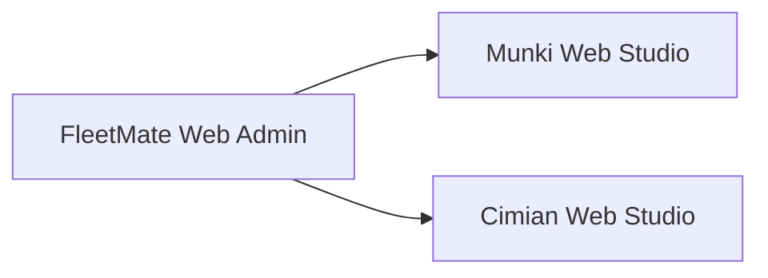

# Standalone and hosted

Status: proposal · 2026-11-04. This page is kept identical in Munki Web Studio and
Cimian Web Studio.

## The rule

Munki Web Studio and Cimian Web Studio are each a complete product: browser UI,
API, repository adapter, worker, sign-in, deployment, docs, and releases. Each
one runs on its own, and neither depends on the other or on FleetMate Web Admin.
An admin who runs only Munki or only Cimian installs one studio and nothing else.

[FleetMate Web Admin](https://github.com/rodchristiansen/fleetmate-web-admin) is
the combined version for admins who run both. It depends on the two studios; the
studios never depend on it. Dependencies point one way:

## What each studio publishes

Every release of a studio publishes two things from the same commit:

1. **The app.** A container image (plus the platform worker package) that runs
   the studio alone, with its own sign-in. This is what most people install.
2. **The package.** The same backend as an importable package
   (`munki_web_studio`, `cimian_web_studio`), and the same browser workspace as
   a built UI module. FleetMate installs both packages and hosts them together.

Both come from one codebase. There is no separate "embedded" fork.

## Hosting contract

To be hostable, a studio's package exposes a small, versioned surface. Each studio
implements it on its own; there is no shared library to import.

| Surface       | What the studio provides                                                                  |
| ------------- | ----------------------------------------------------------------------------------------- |
| Manifest      | Name, version, contract version, platform, brand theme, icon                              |
| API           | A router the host mounts under a prefix, for example `/munki`                             |
| MCP | Its FastMCP server, which the host mounts under a tool prefix such as `munki_` |
| UI            | A workspace module the host mounts under the same prefix                                  |
| Identity hook | Accepts an already authenticated user and roles from the host, instead of its own sign-in |
| Settings      | Its repository and worker configuration, readable and validated by the host               |
| Jobs          | Its job types and worker capabilities, so the host can show one Activity view             |
| Health        | Status for the host's diagnostics page                                                    |

When a studio runs alone, its own app supplies sign-in and settings through the
same hooks. The hosted mode changes who provides them, not how the studio works.

## Shared behavior without shared code

The two studios do the same things in the same way: the workspace layout, drafts,
revision checks, conflict handling, review, jobs, Git, audit. That code is
**copied** into each studio, not imported from a common package. A fix made in
one studio is ported to the other in a matching pull request.

To keep the copies honest, both studios keep that code in the same folder layout
under the same names. FleetMate's CI compares the two copies and reports any
drift. The report is information for the studio maintainers; it never blocks a
studio's own release.

## What this requires of both studios

- The same backend runtime and the same browser framework, so one FleetMate
  process can host both packages.
- The same contract version, or FleetMate pins the last compatible release.
- No imports from FleetMate or from the other studio, checked in CI.
